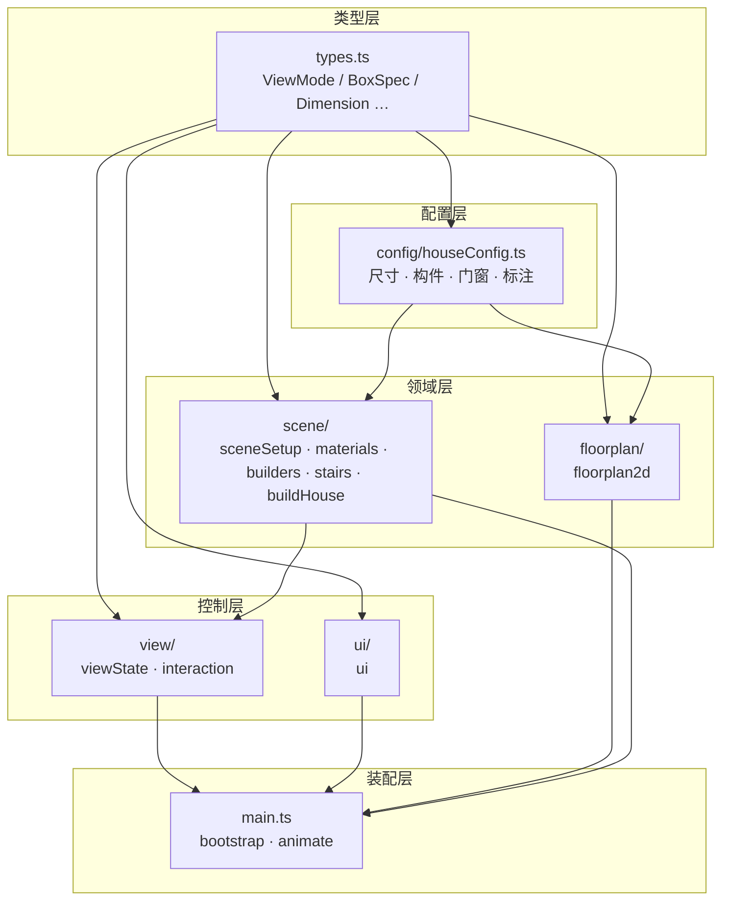
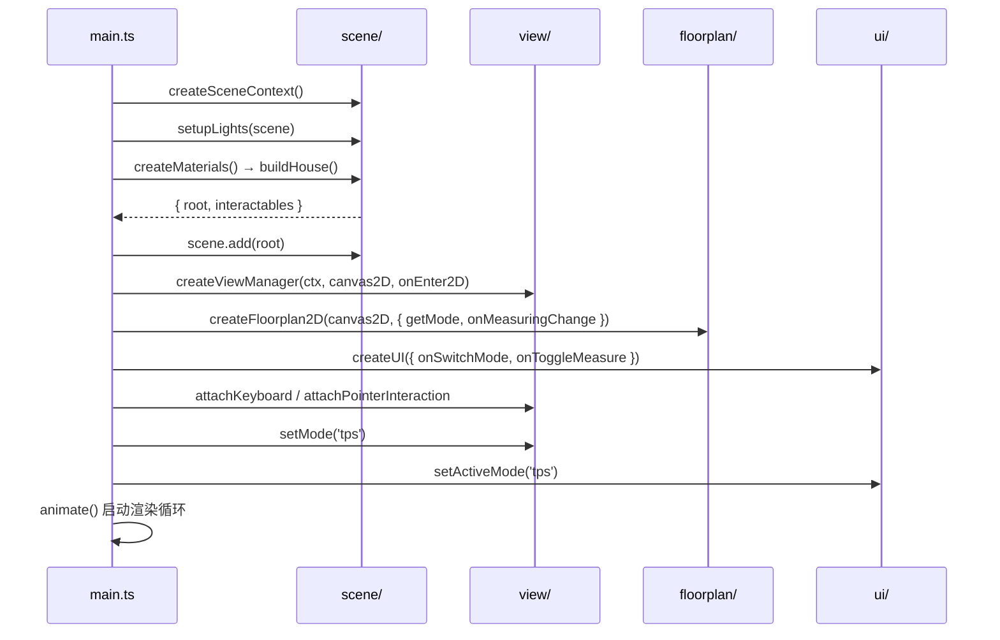
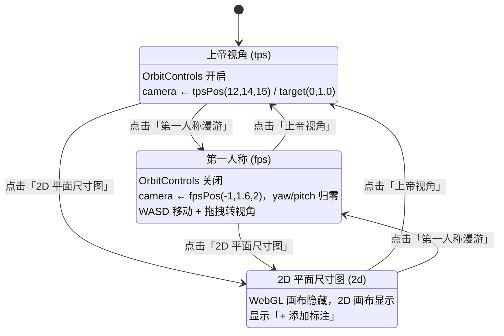
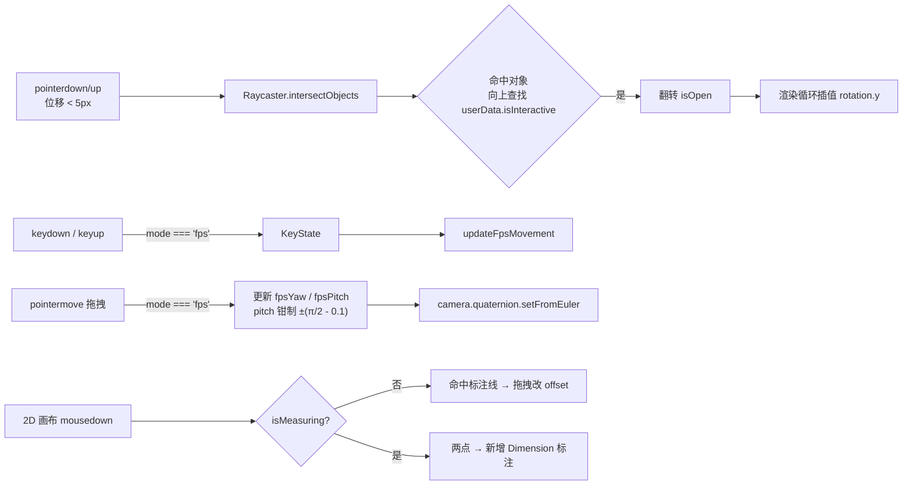

# 架构设计

## 1. 分层与依赖方向

工程按职责分为六层，**依赖严格单向**，无循环引用：



要点：

- **配置层只被读取，不被修改**：`houseConfig.ts` 是纯数据 + 少量推导函数，不 import 任何 three 运行时。
- **`view` 仅以类型方式依赖 `scene`**：`viewState.ts` / `interaction.ts` 只 import `SceneContext` 类型，不反向调用场景构建逻辑。
- **`floorplan` 与 `view` 解耦**：2D 模块不知道视角状态机的存在，通过 `getMode()` 回调获知当前模式；模式变化的副作用（重绘）由 `main.ts` 注入。
- **`ui` 不依赖任何渲染模块**：只负责 DOM 与回调，模式切换的具体动作由 `main.ts` 编排。

## 2. 启动流程



## 3. 视角状态机

三种模式互斥，切换时统一处理**相机位姿、控制器开关、画布可见性**：



各模式下的渲染差异：

| 模式 | OrbitControls | WebGL 画布 | 2D 画布 | 每帧动作 |
| --- | --- | --- | --- | --- |
| `tps` | 启用 | 显示 | 隐藏 | `controls.update()` → 渲染 |
| `fps` | 禁用 | 显示 | 隐藏 | 键盘移动 → 渲染 |
| `2d` | 禁用 | 隐藏 | 显示 | **跳过 WebGL 渲染** |

> 2D 模式下停止 `renderer.render()`，避免隐藏画布时仍产生 GPU 开销。

## 4. 渲染循环

```text
animate()
  ├─ mode === 'tps' → controls.update()
  ├─ mode === 'fps' → updateFpsMovement(keys)
  │      ├─ 由 camera.quaternion 推导水平前/右向量
  │      ├─ 按 WASD/方向键平移
  │      └─ 钳制到户型范围内 (x ±4.3, z ±4.8)，眼高固定 1.6
  └─ mode !== '2d' → updateInteractables() + renderer.render()
         └─ 每个可交互部件向 openAngle / closedAngle 插值 (lerp 0.15)
```

性能细节：FPS 移动与门窗动画复用模块级 `Vector3` / `Euler` 临时对象，避免每帧分配。

## 5. 交互链路



## 6. 关键设计决策

| 决策 | 选择 | 理由 / 取舍 |
| --- | --- | --- |
| 建模方式 | 配置数组驱动（`BoxSpec[]` 循环生成） | 改户型只需改数据；为后续家具组件化留出统一入口。代价是细部微调不如命令式直观 |
| 状态管理 | 轻量工厂函数 + 闭包，不引入框架 | 单一场景、状态极少，引入 Pinia/Zustand 属于过度设计 |
| 单文件发布 | `vite-plugin-singlefile` | 直接内联 JS/CSS，无需额外打包后处理脚本 |
| `three` 版本 | 锁定 `0.160.0` | 与重构前 CDN 版本一致，确保渲染结果（含 `colorSpace`、`PCFSoftShadowMap`）不变 |
| 模块解耦 | 用回调（`getMode` / `onEnter2D`）代替直接 import | `floorplan` 可独立测试与复用 |
| 材质管理 | 集中 `MaterialMap` 字典，`stair` 复用 `floor` 实例 | 材质数量可控，避免重复生成瓷砖贴图 |
| 类型收窄 | `InteractiveObject = Object3D & { userData: InteractiveUserData }` | 在保留 three 原生 `userData` 机制的同时获得类型保护 |
| 资源内联 | 瓷砖贴图用 Canvas 程序化生成 | 无外部图片依赖，才能做到真正的离线单文件 |
