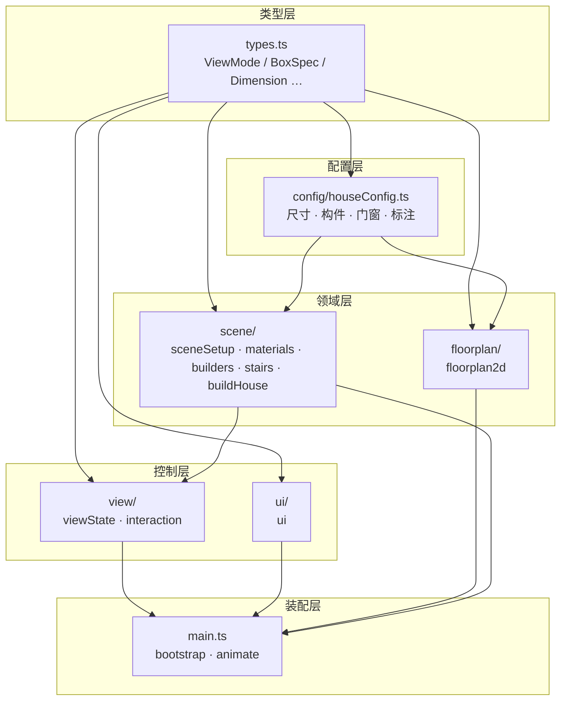
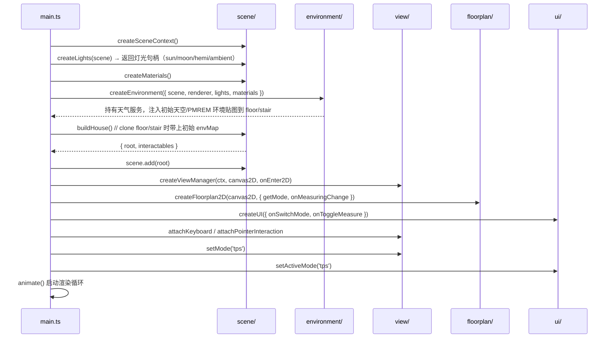
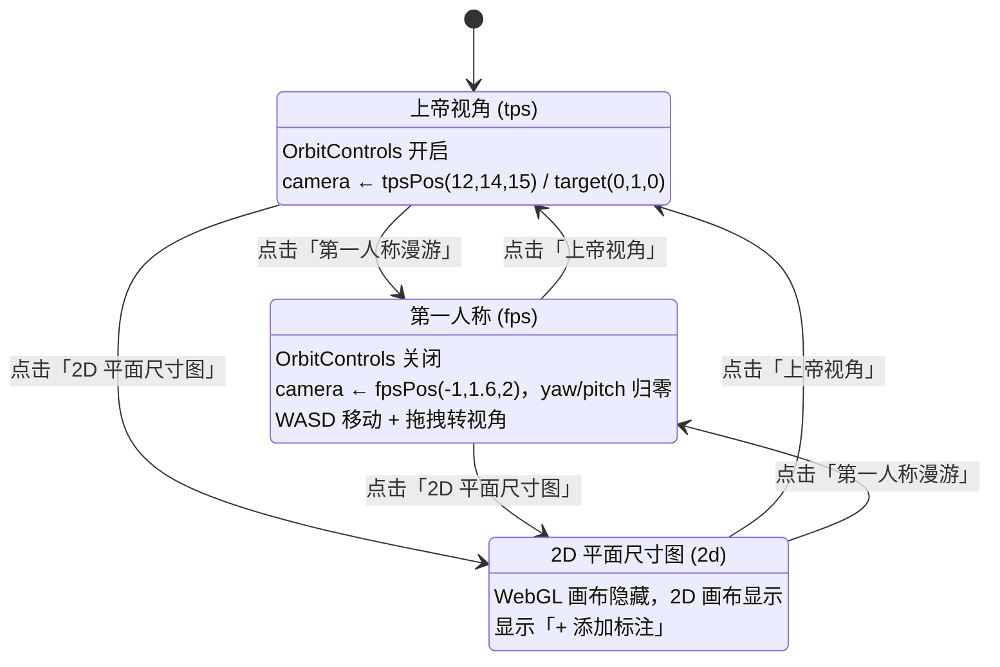
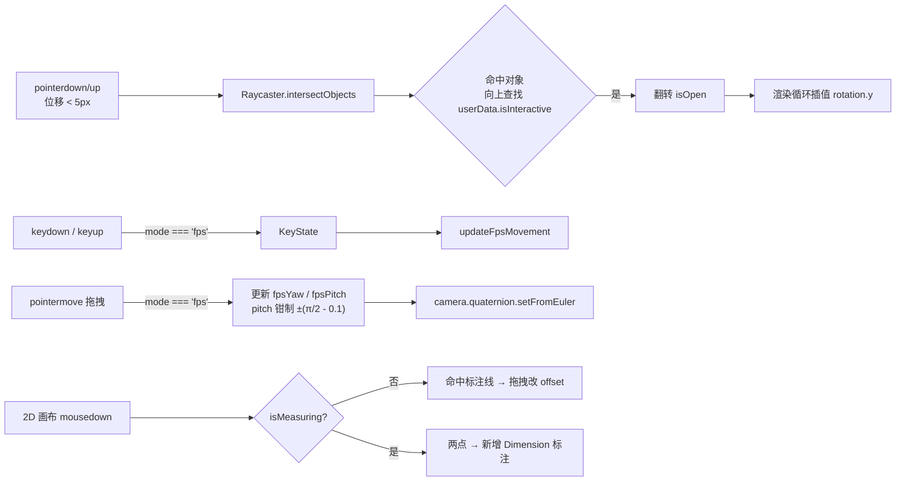
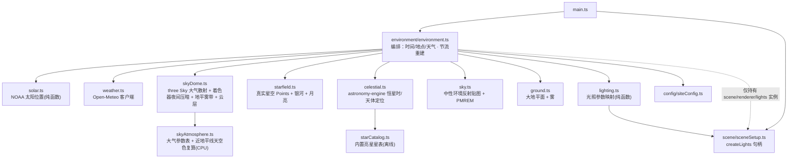

# 架构设计

## 1. 分层与依赖方向

工程按职责分为六层，**依赖严格单向**，无循环引用：



要点：

- **配置层只被读取，不被修改**：`houseConfig.ts` 是纯数据 + 少量推导函数，不 import 任何 three 运行时。
- **`view` 仅以类型方式依赖 `scene`**：`viewState.ts` / `interaction.ts` 只 import `SceneContext` 类型，不反向调用场景构建逻辑。
- **`floorplan` 与 `view` 解耦**：2D 模块不知道视角状态机的存在，通过 `getMode()` 回调获知当前模式；模式变化的副作用（重绘）由 `main.ts` 注入。
- **`ui` 不依赖任何渲染模块**：只负责 DOM 与回调，模式切换的具体动作由 `main.ts` 编排。
- **`environment/` 环境层只依赖 `three` / `types` / `config`**：不 import `scene` / `view` / `floorplan` / `ui`；它通过持有 `scene` / `renderer` / `LightHandles` 实例完成渲染动作（不反向依赖这些模块），由 `main.ts` 在 `buildHouse` 之前创建，把初始环境贴图注入 `floor` / `stair` 材质。`ui/envPanel.ts` 同样只依赖类型与 DOM 回调，通过 `Environment` 实例驱动。

## 2. 启动流程



## 3. 视角状态机

三种模式互斥，切换时统一处理**相机位姿、控制器开关、画布可见性**：



### 楼层切换与视角连贯

视角状态为**全局单例**（`viewState.ts` 的 `state`，含 `tpsPos/tpsTarget/fpsPos/fpsYaw/fpsPitch/mode`），四层共用同一套上帝/第一人称相机——不再逐层独立记忆。切换楼层（`setActiveFloor`）不恢复旧视图，也不平移相机，整栋建筑始终以同一取景居中：

- **上帝视角**：相机与注视点（`tpsPos`/`tpsTarget`）完全不动，整栋建筑始终居中，切层只改变可见楼层集合（`applyVisibility`），不再做楼层高差平移——避免「轨道中心随楼层升高、整栋在画面中下沉」的问题；方位角/俯角/距离与用户手动平移全部保留。
- **第一人称**：保留 `(x, z)` 与 `yaw/pitch`，仅眼高随 `resolveGround(walkAreas[to], …)` 完成面升降；若该水平落点在新层不可行走（`isWalkable` 判否），回退到默认出生点 `VIEW.fpsPos` 的水平坐标 + 新层眼高。朝向沿用、不归零（与模式切换区分）。
- **2D**：无 3D 相机。

首屏机位由 `computeBuildingFrame()` 生成，把**整栋建筑**框入画面中心（注视点取整栋竖向中心、距离自动后拉容纳四层），替代原先按单层层高自适应的 `computeTpsFrame`，因此初始即整栋居中、各层都在视野内。

走楼梯的**自动切层**（`autoSwitchFloor`，脚下为连续物理位移）不移动活动相机、也不平移上帝视角存储，仅把 `state.fpsPos` 记为相机真实位置，保证整栋建筑始终居中。

模式切换（`setMode`）维持既有行为：进入第一人称仍把 `yaw/pitch` 归零、眼高对齐当前活动层；切回上帝视角恢复离开前的 `tpsPos/tpsTarget`（始终为整栋居中的取景）。`saveTpsView()` 每帧把当前轨道相机回存全局状态。

各模式下的渲染差异：

| 模式 | OrbitControls | WebGL 画布 | 2D 画布 | 每帧动作 |
| --- | --- | --- | --- | --- |
| `tps` | 启用 | 显示 | 隐藏 | `controls.update()` → 渲染 |
| `fps` | 禁用 | 显示 | 隐藏 | 键盘移动 → 渲染 |
| `2d` | 禁用 | 隐藏 | 显示 | **跳过 WebGL 渲染** |

> 2D 模式下停止 `renderer.render()`，避免隐藏画布时仍产生 GPU 开销。

## 4. 渲染循环

```text
animate()
  ├─ mode === 'tps' → controls.update()
  ├─ mode === 'fps' → updateFpsMovement(keys)
  │      ├─ 由 camera.quaternion 推导水平前/右向量
  │      ├─ 按 WASD/方向键平移
  │      ├─ 按「可行走区域」分轴推进（屋内 + 门洞通道 + 院子）
  │      ├─ 脚下高度 = 楼梯踏面（逐级）/ 平层完成面 → 眼高 = 脚下 + 1.6（0.09s 插值）
  │      └─ 可见层：脚高越过中段休息台（1F→2F 2.5m / 2F→3F 5.3m）即切上层；UI 楼层（按钮/小地图）按完成面判定（休息台仍显示下层）
  ├─ env.update(mode !== '2d')  → 推进时间/天气；每帧更新 Sky 太阳方向/昼夜/云层与星空透明度，星空位置按 1s 节流；PMREM 环境贴图按太阳方位(≥0.5°)/天气变化节流（最小 150ms）；2D 下仅推进状态、标记回 3D 时强制重建
  └─ mode !== '2d' → updateInteractables() + renderer.render()
         └─ 每个可交互部件向 openAngle / closedAngle 插值 (lerp 0.15)
```

性能细节：FPS 移动与门窗动画复用模块级 `Vector3` / `Euler` 临时对象，避免每帧分配。

## 5. 交互链路



## 6. 关键设计决策

| 决策 | 选择 | 理由 / 取舍 |
| --- | --- | --- |
| 建模方式 | 配置数组驱动（`BoxSpec[]` 循环生成） | 改户型只需改数据；为后续家具组件化留出统一入口。代价是细部微调不如命令式直观 |
| 状态管理 | 轻量工厂函数 + 闭包，不引入框架 | 单一场景、状态极少，引入 Pinia/Zustand 属于过度设计 |
| 单文件发布 | `vite-plugin-singlefile` | 直接内联 JS/CSS，无需额外打包后处理脚本 |
| `three` 版本 | 锁定 `0.160.0` | 与重构前 CDN 版本一致，确保渲染结果（含 `colorSpace`、`PCFSoftShadowMap`）不变 |
| 模块解耦 | 用回调（`getMode` / `onEnter2D`）代替直接 import | `floorplan` 可独立测试与复用 |
| 材质管理 | 集中 `MaterialMap` 字典，`stair` 为独立白色切割瓷砖材质（含环境反射） | 材质数量可控，避免重复生成瓷砖贴图 |
| 第一人称移动 | 不做完整碰撞，用「可行走区域」（屋内矩形 + 门洞通道 + 院子矩形带）分轴推进；楼梯按「踏面高度」贴地，可见层越过中段休息台即切上层（1F→2F 2.5m / 2F→3F 5.3m），UI 楼层按完成面判定 | 与既有"可穿内墙"的漫游手感一致；门洞通道绑定门的开合状态，实现"开门才能出去"；楼梯可直接上下楼。可见层与 UI 楼层解耦，故休息台上已加载上层、按钮仍显示下层。代价：外墙不可穿越，内墙仍可穿行 |
| 类型收窄 | `InteractiveObject = Object3D & { userData: InteractiveUserData }` | 在保留 three 原生 `userData` 机制的同时获得类型保护 |
| 资源内联 | 瓷砖贴图用 Canvas 程序化生成 | 无外部图片依赖，才能做到真正的离线单文件 |

## 7. 环境层（地理日照 + 天气）

新增 `src/environment/`，在既有三视图之上叠加"真实地理日照 + 实时天气"的动态光照与环境。设计目标：太阳按经纬度与（实时或可调）时间算出真实方位并驱动主光/影子/天空；天气实况改变光照氛围；**房屋几何、2D 图纸、三种视角构图一律不变**（仅把"正面 +z 朝西"换算到光照与天空方向）。

### 7.1 模块职责与依赖



- `solar.ts` / `weather.ts` / `skyDome.ts` / `skyAtmosphere.ts` / `starfield.ts` / `celestial.ts` / `sky.ts` / `ground.ts` / `lighting.ts` 为**纯函数或薄封装**，不持有状态；`environment.ts` 是唯一有状态编排器（工厂 + 闭包）。
- `skyDome.ts` / `starfield.ts` / `celestial.ts` / `skyAtmosphere.ts` 只依赖 `three` / `astronomy-engine` / `types` / `config` / 本目录纯模块；`starCatalog.ts` 为提交进仓库的静态星表数据（构建期打包，运行时不联网）。`skyAtmosphere.ts` 是 Sky.js 片元算法的 CPU 复算（只为取"地平色的值"，不参与渲染），升级 three 时必须与 `Sky.js` 同步核对。
- `environment.ts` 只 import `three` / `types` / `config` / 上述纯模块；`ui/envPanel.ts` 只依赖类型与 DOM 回调，通过 `Environment` 实例调用 `setLocation` / `setLive` / `setManualLocalDate` / `refreshWeather`，并被动接收 `onSnapshot` 刷新读数。

### 7.2 太阳位置与"房屋正面朝向"换算

`solar.ts` 以 **UTC 时刻 + 经纬度** 算出太阳高度角 `elevation` 与方位角 `azimuth`（**自正北顺时针**：北 0、东 90°、南 180°、西 270°）。

**设计命名 vs 真实地理**：这里"正门(+z)=南面、后门(−z)=北面"只是设计阶段的称呼习惯；在武穴真实地理中正门(+z)实际朝**西**、后门(−z)实际朝**东**，即房屋主轴（z 轴）与地理东西轴重合（+z→西、−z→东），x 轴对应地理南北（±x→南/北）。因此朝向换算按"正门 +z 所朝真实方位"旋转，该方位由 `siteConfig.FRONT_AZIMUTH_DEG`（默认 270°=西，与默认地点武穴一致）声明，并可由日照面板的"房屋正面朝向"覆盖（`Environment.setFrontAzimuth` → `toSceneDirection` 第二参）：

```
rel  = azimuth - frontAzimuth          // frontAzimuth 默认 3π/2（西）
dir  = ( -sin(rel)·cos(el),  sin(el),  cos(rel)·cos(el) )   // 已归一化
```

校验（frontAzimuth=270° 西）：az=270°(西)→`+z` ✓（正门/西侧受夕照）；az=90°(东)→`-z` ✓（太阳从后门/东侧升起）；az=0°(北)→`-x`；az=180°(南)→`+x`。**几何、2D、视角均不改动**；罗盘指针与日出/日落时刻显示的是地理真实太阳方位，与房屋朝向无关。

日出/日落由 `sunTimes()` 扫描当日高度角跨越 −0.833° 插值求得，再按地点时区换算成本地 HH:MM 供面板显示。

### 7.3 天空、星空与反射

- `skyDome.ts`：`scene.background = null`，背景改由场景内的大半径穹顶承担。白天用 three 自带 `Sky`（Preetham 大气散射）网格，太阳方向复用 `solar.toSceneDirection`，并随天气调整 `turbidity` / `rayleigh` / `mieCoefficient`（参数表在 `skyAtmosphere.ts`）；**夜间压暗写在 Sky 片元着色器里**（`uNightScale`，白昼 1 → 深夜 0.1，输出空间相乘），不再用黑色半透明球罩——球罩有实体边缘，边缘落在地平线附近时会露出一圈未压暗的亮天空，形成横贯画面的亮带。云层用程序化 Canvas 等距柱状贴图（不引入外部图片），按云量与昼夜调不透明度/颜色。
- **穹顶与星穹每帧跟随相机平移**（`environment.update()` 里把 `skyDome.object3D` / `starfield.object3D` 的位置对齐 `camera.position`）。天空盒（±450m）、云层（882m）、星点（880m）、月亮（860m）都小于远裁剪面（1000m）：上帝视角用滚轮 dolly 拉远后，视线中心处的球面到相机距离超过 1000m 会被整片裁掉，天空上就会出现一块圆形缺口（表现为"黑色圆球虚影"）。跟随相机可让球面到相机的距离恒定，任何缩放级别下都不会被裁切。
- 地平线接缝：Sky 片元着色器在 `colorspace_fragment` 之后追加**地平雾色带**——`horizonMix = smoothstep(-0.012, 0.11, direction.y)`，地平线及以下取 `uHorizonColor`（= 雾色），向上约 6° 平滑过渡回大气散射色。注入点在色彩空间转换之后、且雾色按输出空间传值，与材质雾（three 在 `colorspace_fragment` 之后叠雾）逐位同色，因此"地面尽头 / 雾 / 天空下半球"在交界处完全连续。
- `starfield.ts` + `celestial.ts` + `starCatalog.ts`：夜间真实星空。内置 2851 颗视星等 ≤5.5 的亮星（RA/Dec/星等/B-V），`celestial.ts` 用 `astronomy-engine` 求本地恒星时（`SiderealTime`）并把星表赤经赤纬按观测者纬度/经度/房屋正朝向旋转到场景方向；`starfield.ts` 以 `THREE.Points`（加色混合、常量像素尺寸、按星等调大小/亮度、按 B-V 调色温、按地平线高度淡出）渲染。银河为沿银道面程序化采样的暗弱星点云（赤道坐标，随星空一同旋转）；月亮为程序化 Canvas 月面球体，位置由 `astronomy-engine` 的 `Equator` + `Horizon` 求解，地平线以下自动隐藏。
- `sky.ts` 只保留**中性环境反射贴图**：经 `PMREMGenerator` 注入 `floor` / `stair` / `stainlessBrushed`，刻意不含蓝天以避免抛光地面反射发蓝；随昼夜轻度调暗。
- `ground.ts` 为 `y=0.08` 的 1200×1200m 草地/土面（程序化贴图 ×180 平铺，单块约 6.67m，略低于 1F 楼板底 0.10）。地面边缘（600m）已超出最大雾远平面（500m），因此地面尽头必然是纯雾色；地面边缘与真实地平线之间仍有约 1.9°（相机 20m 高）的角度缺口，由 Sky 的**地平雾色带**用同一雾色填平。**不要盲目放大地面**：相机 `VIEW.far = 1000`，超出的部分只会被远裁剪面切掉。

### 7.4 光照映射与可读性补光

`lighting.ts` 由 `computeLighting(solar, weather)` 输出 `LightingParams`：`applyLighting()` 仅修改灯光句柄属性（不新建对象）。策略为**太阳为主 + 保留可读性补光**——太阳决定主要光色（低角度暖橙、正午近白）与方向，保留较弱基准环境光（夜间 0.18、白天约 0.45）+ 半球光，保证三种视角与背光房间仍清晰；夜间转为冷色月光、`castShadow` 关闭。**月光方向不再用"太阳对侧"假值**，而由 `celestial.writeMoonSceneDir`（astronomy-engine）求解，与可见月亮方向一致；月亮位于地平线下时月光强度置 0。`scene.fog` 的远近由天气基值与能见度插值（晴 80/500 → 雾 8/60）。

**雾色（= 地平色）不再来自调色板**，而由 `skyAtmosphere.horizonSkyColorHex()` 在 CPU 上复算 Sky 的 Preetham 片元算法，取"近地平线方位平均色"并复现夜间压暗（`0.1 + 0.9·dayFactor`）。这样天空、雾、远景地面同源同色——若雾色另取一个饱和的地平蓝（旧 `WEATHER_PALETTE.horizon = 0xbcd8ff`），白天会在过曝白的天空下压出一条蓝色横带、夜间会因为偏蓝偏亮而露出一道亮带。

### 7.5 天气（Open-Meteo）与降级

`weather.ts` 向 `https://api.open-meteo.com/v1/forecast`（免 key、支持 CORS）拉取 `current=` 实况（云量/降水/能见度/气温/天气代码），用 `AbortController` 5s 超时 + 序号校验丢弃过期响应 + 页面隐藏暂停轮询（默认 10 分钟刷新，手动可立即刷新）。**任何失败（离线/超时/解析）一律静默降级为晴天**（`FALLBACK_WEATHER`，`stale=true`），不抛未捕获异常、不阻塞首屏或交互；离线打开的单文件仍完全可用。
- **默认关闭**：`WEATHER_ENABLED_DEFAULT = false`，首屏不发任何请求；用户在面板 WEATHER 区开启后才会拉取，关闭时 `setEnabled(false)` 停止轮询并立即切回晴天（`setWeatherEnabled`）。

### 7.6 节流与降级

- `environment.update()` 每帧只做廉价更新：Sky 的太阳方向 uniform、昼夜因子、云层颜色/不透明度，以及星空昼夜透明度；**不每帧重建几何**。
- 星空位置重算按 1 秒签名节流（恒星每小时才转 15°，1Hz 已足够平滑），且仅在时刻/经纬度/房屋朝向变化时触发；银河与月亮共用同一节流。
- 中性环境反射贴图的 PMREM 重建成本较高（约 10~20ms），沿用"太阳方位变化 ≥0.5° 或天气变化 + 最小间隔 150ms"节流；2D 模式不重建但标记，回到 3D 立即重建。
- 对旧 `envMap` 调用 `dispose()` 防泄漏，`dispose()` 时释放 Sky 网格、星空 Points、银河、月亮与云层贴图；切换地点时取消上一次未完成的天气请求。
